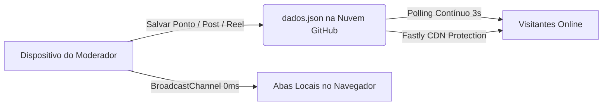

# TangaráPreview 🗺️📍

> **Levantamento Georreferenciado e Cartografia do Território Urbano e Rural de Tangará-RN**  
> *Iniciativa interdisciplinar entre Educação Geográfica e Informática*  
> **IERN — Instituto Estadual de Educação Profissional, Tecnologia e Inovação do Rio Grande do Norte (Campus Tangará)**  
> **SEEC-RN — Secretaria de Estado da Educação, do Esporte e do Lazer**

---

## 🌐 Acesso Rápido

* **Site Oficial no Ar (GitHub Pages)**: [https://tangarapreview.github.io/TangaraPreview/](https://tangarapreview.github.io/TangaraPreview/)
* **Canal Oficial no YouTube**: [@Tangara_Preview](https://www.youtube.com/@Tangara_Preview)
* **Perfil Oficial no Instagram**: [@tangarapreview](https://www.instagram.com/tangarapreview/)

---

## 👥 Equipe do Projeto

* **Professor Orientador**: Prof. Jonas Lopes de Medeiros
* **Estudantes e Desenvolvedores (Curso Técnico em Informática — IERN Tangará)**:
  * Daniel Santos Diniz
  * Jean Pierry Ribeiro Barbosa
  * José Irinel Júnior
  * Yuri Gabriel Costa de Morais

---

## 🚀 Funcionalidades e Estrutura do Portal (v3.5)

O portal é organizado em 5 seções principais de navegação fluida:

### 1. 🗺️ Mapa Interativo & Cartografia Georreferenciada
* Mapeamento interativo com camadas de satélite de alta definição (**Google Satélite**) e ruas (**Google Ruas / OSM**).
* Cadastro e consulta de pontos com geolocalização exata, categorias temáticas, fotografias, descrições históricas e rotas.
* Filtros dinâmicos e busca em tempo real com marcadores visuais personalizados.

### 2. 📰 Blog Histórico & Noticiário
* Produção e leitura de artigos, ensaios historiográficos e pesquisas orais sobre a formação territorial de Tangará.
* Editor de texto rico (Quill.js) com suporte a formatação, títulos, citações e inclusão de mídias.
* Histórico de postagens com data, autoria e leitura responsiva.

### 3. 📺 Canal de Vídeos Documentais (YouTube)
* Integrado ao canal oficial do projeto [**@Tangara_Preview**](https://www.youtube.com/@Tangara_Preview).
* Apresentação com banner panorâmico oficial, foto de perfil, dados do canal e botão de inscrição direta.
* Galeria de documentários audiovisuais e reportagens sobre Tangará com player responsivo oficial.

### 4. 📷 Aba Exclusiva do Instagram (Reels & Fotos)
* Conectada diretamente ao perfil oficial [**@tangarapreview**](https://www.instagram.com/tangarapreview/).
* Identidade visual com banner gradiente, foto de perfil com anel de Story oficial e biografia institucional.
* **Player vertical otimizado para Reels (`aspect-[9/16]`)** e contêiner proporcional para postagens de fotos (`aspect-[4/5]`).
* Detecção automática de formato (`Reel` / `Post`) com badges dinâmicos, botões diretos **"Ver no Instagram ↗"** e **"Copiar link"**.

### 5. ℹ️ Sobre nós & Memorial Acadêmico
* Detalhamento institucional, objetivos pedagógicos, metodologia da pesquisa e referências bibliográficas do projeto.
* Apresentação da equipe de estudantes e do professor orientador do IERN Campus Tangará.

---

## ⚡ Motor de Sincronização em Tempo Real (Realtime Cloud Engine)

O TangaráPreview opera com uma arquitetura moderna e autônoma, sem necessidade de servidores pagos ou bancos de dados complexos:



1. **Sincronização Nuvem Global (`dados.json`)**:
   * Sempre que um moderador cria, edita ou exclui um ponto, post, vídeo ou Reel, a alteração é enviada via API REST do GitHub com anti-cache.
   * Visitantes online recebem novos dados a cada **3 segundos** automaticamente, sem precisar recarregar a página.
2. **Sincronização Instantânea Multi-Aba (0ms)**:
   * Usa `BroadcastChannel` (`tangara_preview_sync_v3`) para replicar dados entre abas abertas no mesmo navegador instantaneamente.
3. **Proteção Anti-Rollback (CDN Fastly)**:
   * Controle estrito de versão e timestamps locais que impede que respostas antigas de cache do CDN da internet revertam edições recentes.

---

## 🔐 Segurança & Criptografia

* **Criptografia AES-GCM (256 bits)**: Credenciais e chaves são decifradas apenas em memória durante a sessão autenticada.
* **Hash Criptográfico SHA-256**: Validação rigorosa de senhas locais sem armazenamento em texto puro.
* **Proteção contra Força Bruta**: Bloqueio progressivo de tentativas consecutivas incorretas.
* **Controle de Acesso Baseado em Papéis**: Visitantes têm acesso somente-leitura; apenas desenvolvedores e moderadores cadastrados possuem permissão para adicionar ou remover conteúdos.

---

## 🛠️ Tecnologias Utilizadas

* **Frontend**: HTML5 Semântico, Tailwind CSS, JavaScript Vanilla (ES6+)
* **Mapas**: Leaflet.js, OpenStreetMap Tiles, Google Satellite & Streets Imagery
* **Editor**: Quill.js
* **Criptografia**: Web Crypto API (`window.crypto.subtle`)
* **Ícones**: Lucide Icons (SVG Inline)
* **Hospedagem & CI/CD**: GitHub Pages, GitHub Actions, GitHub REST API v3

---

## 📦 Como Executar Localmente

Não requer instalação de Node.js, PHP ou compiladores. Para rodar:
1. Baixe ou clone o repositório:
   ```bash
   git clone https://github.com/tangarapreview/TangaraPreview.git
   ```
2. Abra o arquivo `index.html` em qualquer navegador moderno (Chrome, Edge, Firefox, Safari).

---

## 📄 Licença e Direitos Autorais

© 2026 **TangaráPreview** — IERN Campus Tangará (Prof. Otacílio Barreto Neto / SEEC-RN).  
Todos os direitos reservados à equipe acadêmica do projeto.
